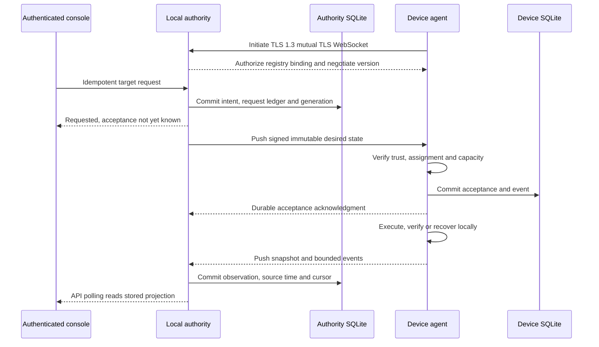

# Authority, transport and synchronization

**Status:** Accepted contracts; protocol specification and implementation
pending. [ADR 0002](../adr/0002-local-first-mvp-boundaries.md) explains local
authority; [ADR 0005](../adr/0005-authenticated-push-transport.md) records
transport selection.

## Durable authority and acceptance

One logical deployment writer owns each device assignment. MVP uses one local
Rust/Tokio authority, configured peers and manual provisioning. Discovery, relay
participation and membership cannot grant deployment authority. Do not merge
execution authority blindly or take over automatically when a writer is
unreachable.

The authority transactionally persists request idempotency, intent and monotonic
generations scoped to authority/assignment/device. API request retries and
device instruction retries are distinct idempotency boundaries. Persist the
immutable payload and signing-key binding so pending delivery is rebuildable
after restart.

The versioned instruction binds protocol version, tenant, asset, device,
assignment, authority, generation, request ID, release ID and descriptor digest.
The [security contract](security.md#signed-inputs) owns signing/trust
requirements. After authentication, authorization and validation, apply these
rules:

| Received instruction | Required handling |
| --- | --- |
| Wrong identity/assignment/authority/key, invalid signature, malformed or unsupported version | Reject before acceptance or process effects |
| Insufficient bounded acceptance capacity | Reject overload before durable acceptance |
| Lower generation | Reject stale |
| Same generation, identical immutable payload semantics | Reuse persisted acceptance/outcome, regardless of transport/signature representation |
| Same generation, conflicting payload | Reject conflict |
| Higher generation targeting already healthy active software | Commit and satisfy without process replacement |
| Higher generation targeting different software | Commit and reconcile through one serialized deployment worker |

Commit accepted intent and its event before application acknowledgment.
Transport receipt is not this acknowledgment. Lost acknowledgments permit replay
without repeated activation. Supersede only at specified safe points: complete
critical transitions to a safe state before processing latest accepted intent;
unstarted superseded work need not execute. Terminal failed generations do not
loop forever; a new generation can request another attempt. Rollback is a new
generation.

## Selected transport

Devices initiate direct WebSocket connections over TLS 1.3 mutual TLS to the
configured local authority. Both ends push transitions on the established
session. Validate peer identity and registry bindings as well as certificate
trust; terminate or revalidate live sessions at credential expiry. Use
heartbeats, bounded deadlines, and jittered reconnect/backoff. Direct
connectivity is configured, without discovery, a broker, mesh routing or a
mandatory cloud/site gateway.

MQTT is a valid local/offline broker/pubsub alternative. The selected direct MVP
topology does not need its additional broker. It remains an optional justified
integration. QUIC, discovery, NAT traversal and relays belong to FUT-01.
Durability, authorization and idempotency stay application contracts regardless
of transport acknowledgment or broker QoS. No new transport-choice experiment is
needed.

Browser traffic is separate: authenticated local API and bounded polling of
stored authority projections. Browser refreshes must never trigger per-device
polls or allocate a database connection per robot. Same-origin/CSRF protection
applies to writes; API request IDs prevent accidental generation allocation on
retries.

## Disconnected and restored state

| Condition | Contract |
| --- | --- |
| Internet lost, local authority reachable | New authorized local deployments work with trusted local inputs/resources |
| Authority lost after durable acceptance | Agent completes/restarts/recovers accepted work locally |
| Device unreachable before delivery | Intent stays pending; deliver only latest relevant intent after reconnect |
| All authorized sources unreachable | Do not invent new desired state |
| Network credential expires | Block new authorizations, terminate or revalidate sessions; accepted local work continues subject to trusted inputs/resources |
| Revocation while offline | No instantaneous revocation guarantee; specify enforcement when connectivity returns |
| Corrupt/unreadable database | Fail explicitly, preserving evidence; never silently reset state/identity |
| Stale authority backup with lost request ledger | Quarantine ambiguous state; do not raise counters and replay old intent automatically |
| Projection rebuild/restore | Do not replay commands or replace device-local execution truth |
| Future authority transfer | Require device-side fencing/confirmation; unreachable transfer stays pending |

## Bounded synchronization and freshness

Reconnect exchanges current snapshots and cursor-based retained-event catch-up
independently from desired-state delivery. Deduplicate by source
identity/sequence, reject regressing snapshots and commit ingestion cursors with
events. Report a retention gap when a cursor is older than retained history.
Recovery-critical metadata lives outside prunable event history.

Coalesce superseded current-state snapshots while preserving source
sequence/time and terminal outcomes. Keep source health time, intermediary
receipt time and last contact separate. Reconnect, heartbeat or database reload
cannot make an old health observation fresh. Show desired, accepted, active,
outcome, liveness, health and contact independently, including
unknown/stale/disconnected and partial results.

Each owning implementation records finite message/payload/page sizes, session
and queue capacities, output/history/disk budgets, timeouts and retries with
overload behavior. Reserve critical state/recovery space. Fair command,
current-state and history service classes prevent slow/disconnected peers or
catch-up history from starving control; pending work rebuilds from durable
intent instead of an unlimited retry queue. Workload log tails remain bounded,
source/attempt-correlated and explicit about truncation/gaps. Browser readers
use these stored projections.

## Delivery and evidence

[M4-01 (#25)](https://github.com/gleniosp/fleetforge/issues/25) defines exact
message encoding, signature bytes/key IDs, versioning, limits, safe points and
failure fixtures. [M4-02
(#26)](https://github.com/gleniosp/fleetforge/issues/26) owns the request ledger
and restore quarantine. Implementation slices
[#88](https://github.com/gleniosp/fleetforge/issues/88),
[#89](https://github.com/gleniosp/fleetforge/issues/89),
[#27](https://github.com/gleniosp/fleetforge/issues/27),
[#28](https://github.com/gleniosp/fleetforge/issues/28),
[#90](https://github.com/gleniosp/fleetforge/issues/90),
[#29](https://github.com/gleniosp/fleetforge/issues/29) and
[#91](https://github.com/gleniosp/fleetforge/issues/91) include their own
negative trust, replay, expiry, restart, cursor and freshness tests.

[M4-11 (#92)](https://github.com/gleniosp/fleetforge/issues/92) measures the
existing limits with synthetic peers plus three real agents: reconnect storms,
slow peers, history pressure and browser readers must preserve command progress
and recovery space. Declare host, rates, durations, memory/disk/queue and
latency budgets. These measurements do not establish million-device production
capacity.
