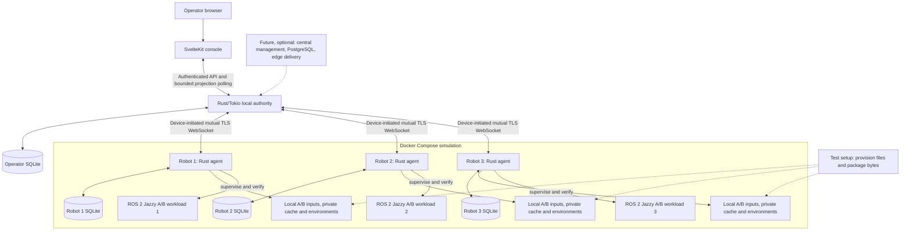
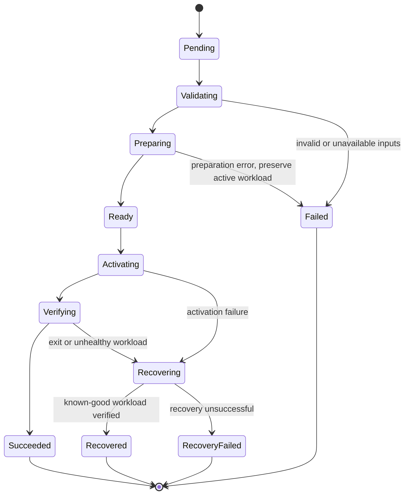
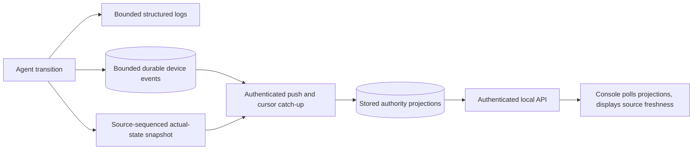

# FleetForge architecture

**Status:** Accepted boundaries and invariants; components are planned. Defaults
labelled below require bounded validation before becoming implementation claims.
The [product requirements](../product/requirements.md) own capability
acceptance.

| Contract owner | Subject |
| --- | --- |
| [Identity](identity.md) | Asset/device lifecycle, tenancy and assignment history |
| [Coordination](coordination.md) | Authority, signed-intent semantics, selected transport, offline behavior, synchronization and freshness |
| [Security](security.md) | Initial threat model, signatures, credentials and workload privilege boundary |
| This overview | Components, release preparation, local lifecycle, persistence and simulation |
| [Future architecture](future.md) | All twelve deferred capability constraints and scale evidence |

Rust/Tokio owns agent and logical authority services; SvelteKit/TypeScript owns
the console. These framework choices and the direct authenticated push transport
are accepted. Package compatibility, OS behavior and finite implementation
limits still need evidence; they are not reasons to reopen the product choices
by default.

## Components and topology

The diagram shows the intended complete MVP, not bootstrap services. The browser
uses the operator API; it does not control agents or read robot databases
directly. Future services are optional additions, never prerequisites for local
execution.

| Component | Responsibility and authoritative data |
| --- | --- |
| Authority | Persist tenant/asset/device/assignment registry, credentials, authority, configured inventory, desired generations/request IDs, delivery/acceptance, and last observations |
| Agent | Persist accepted intent, attempts, active/known-good release and recovery metadata; inspect and supervise actual processes |
| Device SQLite | Local identity/ownership/assignment, durable execution and recovery state, migrations, bounded lifecycle events |
| Authority SQLite | Durable requested state and bounded projections of robot status/events |
| Release catalog | Consistent publisher-signed immutable identities/descriptors known to operator and agents |
| Pixi | Resolve/install locked runtime environments; no application-level activation, supervision, authorization, or recovery guarantee |
| SvelteKit | Controls and honest presentation of operator observations and their freshness |
| Compose/test setup | Independent process/storage fixtures, pre-provisioning and controlled failures |

One process owner writes each local database. Start with modules inside the
agent; introduce the operator package when it has real responsibilities and
extract shared protocol code only when both consumers exist. Do not pre-create
core/network/edge crates or cloud directories.

## Release and delivery boundary

Each headless ROS 2 Jazzy Python A/B release owns a publisher-signed immutable
descriptor, files, Pixi manifest/lockfile, entrypoint, and health contract. The
catalog maps a stable release ID to its descriptor/digest and local location.
Detailed descriptor/path/schema rules belong to
[M1-01](https://github.com/gleniosp/fleetforge/issues/10).

Before deployment scenarios, provision each relevant robot with release inputs
and all dependency bytes needed for offline installation. The operator sends
release identity/integrity, not artifacts. Resolve and verify publisher
trust/integrity locally before preparation and activation; unavailable,
untrusted or corrupt inputs fail without disturbing the running workload.
Package caches and installed environments are separate resources. Preparation
uses a dedicated release environment rather than the repository's development
environment.

Pixi resolves, locks and installs environments; evaluate pixi-pack for packaging
where useful. FleetForge owns desired state, authorization, supervision, health,
activation/recovery and future transfer/cache policy. Pixi does not supply fleet
coordination, peer distribution or atomic process switching. [ADR
0001](../adr/0001-pixi-cargo-and-task-ownership.md) records this ownership
decision. [Security](security.md#signed-inputs) owns descriptor trust and the
specifications that must define exact signed bytes/key IDs.

## Desired state and reconciliation

The [coordination contract](coordination.md) owns the instruction/failure table,
durable-before-ack sequence, authenticated push sessions, bounded event catch-up
and source freshness. Discovery or transport membership never grants deployment
authority. The browser reads stored projections through the authenticated API.

## Deployment and recovery

An attempt outcome, desired release, active release, and current workload health
are independent fields. `Recovered` means the requested deployment failed and
known-good software is running again; desired B can remain unsatisfied while
healthy A is active. Requested rollback to A is a new generation with its own
attempt, not an automatic-recovery event.

The following invariants are fixed:

- Serialize incompatible active-workload changes per robot.
- Prepare separately from active software; preserve known-good inputs and retain A.
- Require actual workload health, release and process-instance identity before
  success, so an old process cannot satisfy a new attempt's verification.
- Bound startup, shutdown, verification, retry, and process-output work.
- Expose absent/unhealthy workloads and failed recovery honestly.
- Inspect database, filesystem, and verified process ownership on startup.

Controlled stop/start is the selected activation model. Temporary interruption
is acceptable. The agent must own child shutdown, escalation, descendant
handling, reaping, and unexpected-exit behavior; a saved PID alone is
insufficient evidence of ownership. A supervision experiment must establish what
happens when the agent dies independently of its workload/container.

Persist intent before external side effects, then record observed results.
SQLite does not atomically control filesystem changes or OS processes. On
restart inspect all three domains and resume/recover from evidence; unknown
ownership must not lead to killing an unrelated process or silently launching a
duplicate. Tests interrupt at each significant boundary. These are
crash-recoverable staged operations, not one atomic SQLite/filesystem/process
transaction or exactly-once execution. Application-data migration reversibility
is separate; MVP workloads avoid incompatible persistent-data migrations.
Detailed rules belong to
[M3-01](https://github.com/gleniosp/fleetforge/issues/19) and
[M3-05](https://github.com/gleniosp/fleetforge/issues/23).

## Persistence and async ownership

Introduce migrations with the first database. Keep robot and operator state in
separate durable local volumes. Extend schemas as desired state and deployment
concepts arrive. Include tenant/asset/device/assignment/authority context from
the first schema as required by [identity](identity.md); do not scaffold future
central services or organization/role management.

A bounded dedicated SQLite worker is the proposed access model; synchronous
database work must not monopolize Tokio executor threads. Local WAL, foreign
keys, full synchronous durability, and busy handling are proposed settings to
validate against actual storage/crash behavior. Durable records must detect
inconsistent identity and corrupt/unreadable state without silently replacing
it.

## Observability and freshness

Introduce diagnostics with each operational slice. Logs identify component,
tenant/asset/device/assignment/authority, request/attempt, release/generation,
phase, timestamps, durations and actionable errors without secrets. Keep general
process output and bounded local security decisions separate from lifecycle
history. [Coordination](coordination.md#bounded-synchronization-and-freshness)
owns snapshot, cursor, retention-gap, protected recovery metadata and source
freshness rules. The UI exposes independent liveness, health,
desired/accepted/active/outcome, last contact and partial results; reconnect is
not proof of fresh source health.

## Simulation and robotics evidence

Use Linux x86_64 with Ubuntu 24.04 as the reference container. Real headless ROS
2 Jazzy Python A/B workloads have independent manifests/locks/runtimes and
observably different behavior beyond metadata. Health verifies actual ROS
lifecycle/message/ service behavior plus release/process-instance identity.
Isolate ROS domains and fixtures so a neighbor or stale process cannot satisfy
health. Earlier process-unit fixtures may stay small/generic. Gazebo,
hardware/navigation and physical pilots are deferred extensions of this real MVP
slice.

Validate the actual RoboStack/Pixi package combination in
[M1-02](https://github.com/gleniosp/fleetforge/issues/11). Preserve/reproduce an
upstream gap rather than silently substituting a generic mock; follow the
[bounded upstream policy](../README.md#bounded-upstream-collaboration). [ROS
REP-2000](https://www.ros.org/reps/rep-2000.html) supplies distro/platform
context and [RoboStack setup](https://robostack.github.io/GettingStarted.html)
supplies package setup guidance, neither of which establishes FleetForge runtime
compatibility.

Compose runs one authority and three independent robots, adding the real console
when implemented. Each device owns private SQLite/runtime/environment/cache
paths, credentials and mutable release storage. Provision release/package bytes
as setup; this is not distributed transfer. Scenario-specific projects/volumes
and explicit reset prevent neighbor interference. Normal shutdown preserves
persistent state.

Separate internet, device-authority WSS and browser access paths. Positive and
negative actual connection probes prove independent allowed/blocked paths. Keep
required local ROS health paths reachable. Use deterministic acceptance/phase
barriers and bounded waits rather than arbitrary sleeps. The [offline scenario
contract](../product/requirements.md#mvp-10--constrained-offline-operation) owns
A–F; [M5-05](https://github.com/gleniosp/fleetforge/issues/93) owns the network
fixtures. The [threat model](security.md) governs credentials, permissions and
exposure.

## Decisions still requiring experiments

| Milestone owner | Question and evidence | Default and revisit trigger |
| --- | --- | --- |
| [M0-03](https://github.com/gleniosp/fleetforge/issues/3) | Does clean Linux Pixi provisioning supply compiler, formatter, linter and linker without host leakage? | Pinned stable toolset; change if package compatibility or clean-build evidence fails |
| [M1-02](https://github.com/gleniosp/fleetforge/issues/11) | Does the actual RoboStack/Pixi combination run isolated ROS 2 Jazzy A/B health on the reference container? | Real ROS behavior; reproduce package gaps with an actionable handoff |
| [M1-05](https://github.com/gleniosp/fleetforge/issues/14) | Can an absent runtime environment be installed from isolated cached bytes? | Locked offline Pixi install; revisit cache strategy if required bytes/metadata are incomplete |
| [M3-03](https://github.com/gleniosp/fleetforge/issues/21) | Can supervised stop/start recover across crashes without duplicate/unknown children? | Direct child/process-group supervision; evaluate a small supervisor only if evidence requires it |
| [M4-11](https://github.com/gleniosp/fleetforge/issues/92) | Do implemented WSS/session, fairness and catch-up limits preserve control under pressure? | Selected direct mutual TLS WebSocket; measure finite limits, not transport selection |
| [M5-05](https://github.com/gleniosp/fleetforge/issues/93) | Can internet and control paths be interrupted independently and verified? | Compose topology plus controlled actions; revise based on real probes |

Follow the evidence rules in [ADR
0003](../adr/0003-bounded-decisions-and-evidence.md). The [traceability
map](../traceability.md) connects these boundaries to requirement verification.
Future capability implementations must not become implicit prerequisites of
these experiments. Identity/ownership and essential security are already MVP
contracts; [future architecture](future.md) defines their deferred extensions.
