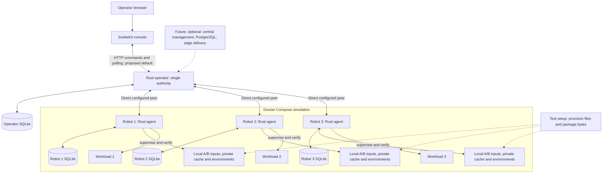
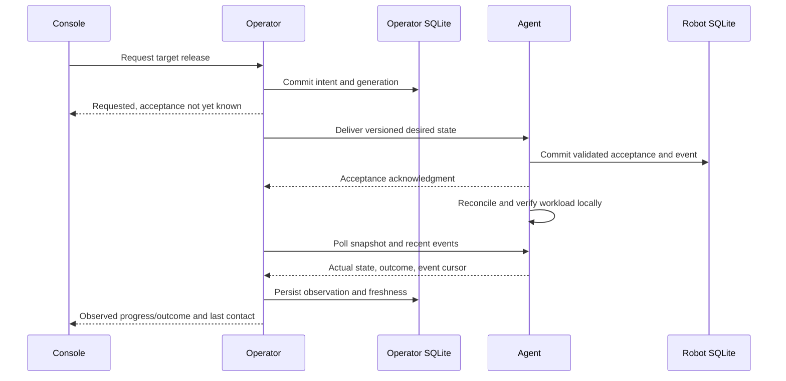
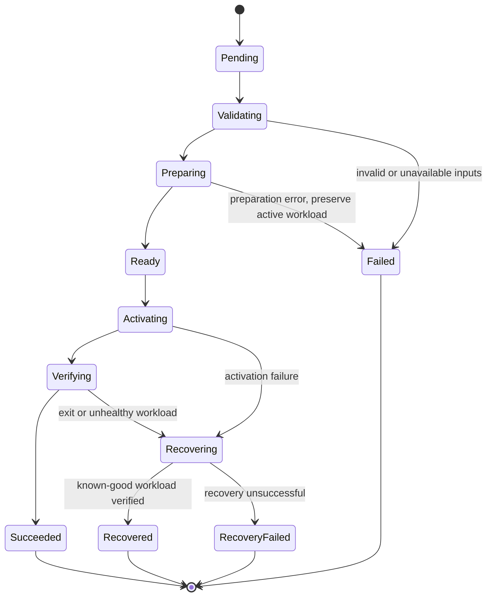
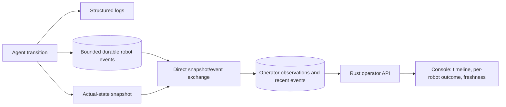

# MVP architecture

**Status:** Accepted boundaries and invariants; components are planned. Defaults
labelled below require bounded validation before becoming implementation claims.
The [product requirements](../product/requirements.md) own capability acceptance.

## Components and topology

The diagram shows the intended complete MVP, not bootstrap services. The browser
uses the operator API; it does not control agents or read robot databases directly.
Future services are optional additions, never prerequisites for local execution.

| Component | Responsibility and authoritative data |
| --- | --- |
| Operator | Persist authority, configured inventory, desired generations/request IDs, delivery/acceptance, and last observations |
| Agent | Persist accepted intent, attempts, active/known-good release and recovery metadata; inspect and supervise actual processes |
| Robot SQLite | Local durable execution and recovery state, migrations, bounded lifecycle events |
| Operator SQLite | Durable requested state and bounded projections of robot status/events |
| Release catalog | Consistent immutable identities/descriptors known to operator and agents |
| Pixi | Resolve/install locked runtime environments; no application-level activation, supervision, authorization, or recovery guarantee |
| SvelteKit | Controls and honest presentation of operator observations and their freshness |
| Compose/test setup | Independent process/storage fixtures, pre-provisioning and controlled failures |

One process owner writes each local database. Start with modules inside the agent;
introduce the operator package when it has real responsibilities and extract shared
protocol code only when both consumers exist. Do not pre-create core/network/edge
crates or cloud directories.

## Release and delivery boundary

Each A/B release owns an immutable descriptor, files, Pixi manifest/lockfile,
entrypoint, and health contract. The catalog maps a stable release ID to its
descriptor/digest and local location. Detailed descriptor/path/schema rules belong
to [M1-01](https://github.com/gleniosp/fleetforge/issues/10).

Before deployment scenarios, provision each relevant robot with release inputs
and all dependency bytes needed for offline installation. The operator sends
release identity/integrity, not artifacts. Resolve and validate locally; unavailable
or corrupt inputs fail without disturbing the running workload. Package caches
and installed environments are separate resources. Preparation uses a dedicated
release environment rather than the repository's development environment.

## Desired state and reconciliation

The operator persists intent and allocates per-robot generations transactionally.
The proposed versioned envelope contains authority ID, robot ID, generation,
request ID, release ID, and descriptor digest. API submission retries also need
idempotency so a repeated button click/request does not allocate another generation.

| Received instruction | Required handling |
| --- | --- |
| Wrong authority/robot, malformed or unsupported version | Reject with actionable error |
| Lower generation | Reject as stale |
| Same generation and identical immutable instruction | Return persisted acceptance/outcome; do not reactivate |
| Same generation with conflicting instruction | Reject as conflict |
| Higher generation for already healthy active release | Persist and satisfy without process replacement |
| Higher generation for different target | Persist and reconcile through one serialized deployment worker |

Only acknowledge acceptance after the database commit. Lost acknowledgments may
cause retries but must not repeat activation. A terminal failed generation stays
failed/unsatisfied after bounded retries; it must not cause an endless recovery
loop. A new generation can request another attempt. During a critical transition,
finish to a documented safe state before reconciling the latest accepted intent;
unstarted superseded intent need not execute.

Direct HTTP/JSON with polling is the proposed initial transport, using configured
addresses, bounded messages/timeouts, and retry/backoff. There is one authority,
not a multi-master mesh. Reconnect synchronizes latest desired intent, current
actual snapshots, and available recent events. Message/API details are owned by
[M4-01](https://github.com/gleniosp/fleetforge/issues/25).

## Deployment and recovery

An attempt outcome, desired release, active release, and current workload health
are independent fields. `Recovered` means the requested deployment failed and
known-good software is running again; desired B can remain unsatisfied while
healthy A is active. Requested rollback to A is a new generation with its own
attempt, not an automatic-recovery event.

The following invariants are fixed:

- Serialize incompatible active-workload changes per robot.
- Prepare separately from active software; preserve known-good inputs and retain A.
- Require actual workload health, release and process-instance identity before
  success, so an old process cannot satisfy a new attempt's verification.
- Bound startup, shutdown, verification, retry, and process-output work.
- Expose absent/unhealthy workloads and failed recovery honestly.
- Inspect database, filesystem, and verified process ownership on startup.

Controlled stop/start is the proposed activation default. Temporary interruption
is acceptable. The agent must own child shutdown, escalation, descendant handling,
reaping, and unexpected-exit behavior; a saved PID alone is insufficient evidence
of ownership. A supervision experiment must establish what happens when the agent
dies independently of its workload/container.

Persist intent before external side effects, then record observed results. SQLite
does not atomically control filesystem changes or OS processes. On restart inspect
all three domains and resume/recover from evidence; unknown ownership must not lead
to killing an unrelated process or silently launching a duplicate. Tests interrupt
at each significant boundary. Detailed rules belong to
[M3-01](https://github.com/gleniosp/fleetforge/issues/19) and
[M3-05](https://github.com/gleniosp/fleetforge/issues/23).

## Persistence and async ownership

Introduce migrations with the first database. Keep robot and operator state in
separate durable local volumes. Extend schemas as desired state and deployment
concepts arrive, rather than creating speculative tenant/central tables.

A bounded dedicated SQLite worker is the proposed access model; synchronous
database work must not monopolize Tokio executor threads. Local WAL, foreign keys,
full synchronous durability, and busy handling are proposed settings to validate
against actual storage/crash behavior. Durable records must detect inconsistent
identity and corrupt/unreadable state without silently replacing it.

## Observability and freshness

Logs identify component/robot/operator, release/generation, correlation and errors
without secrets. Lifecycle events are durable history, not unlimited stdout or a
complete security audit. Use event IDs/sequences for deduplication and snapshot
ordering; expose a gap when a reconnect cursor predates retention. Preserve active
attempt/recovery metadata outside prunable history.

Agent liveness is independent of workload health. The operator records receipt
time and sequence with each observation; the UI must distinguish unknown, fresh,
stale, and disconnected state. A last-observed healthy snapshot does not prove a
currently healthy robot. Do not combine mixed fleet outcomes into global success.

Proposed starting values are two-second polling, ten-second staleness, repeated
health passes within a bounded deadline, and a configurable 1,000-event recent
history per robot in each relevant store. These are defaults to validate, not
current guarantees. Avoid overlapping polling/SSE/WebSocket mechanisms.

## Simulation, offline boundaries, and trust

Use private robot storage/cache/environment paths and scenario-specific Compose
projects/volumes. Provision release bytes as setup; never count this as distributed
artifact transfer. Add the frontend service when it exists. Normal down/up retains
state; explicit reset targets only designated fixture resources.

Separate control communication from internet access. Positive probes must prove
paths that should remain available, and negative probes must prove the intended
partition. Use deterministic acceptance/phase barriers rather than arbitrary
sleeps. The [offline scenario contract](../product/requirements.md#mvp-10--constrained-offline-operation)
owns the independently required A–F conditions.

Expose developer interfaces only as needed; avoid public robot control ports,
validate protocol/IDs/paths, and never derive arbitrary shell commands from network
input. Hash integrity is not authentication. Untrusted-network and production
security work remains a prerequisite outside the MVP.

## Decisions still requiring experiments

| Milestone owner | Question and evidence | Default and revisit trigger |
| --- | --- | --- |
| [M0-03](https://github.com/gleniosp/fleetforge/issues/3) | Does clean Linux Pixi provisioning supply compiler, formatter, linter and linker without host leakage? | Pinned stable toolset; change if package compatibility or clean-build evidence fails |
| [M1-05](https://github.com/gleniosp/fleetforge/issues/14) | Can an absent runtime environment be installed from isolated cached bytes? | Locked offline Pixi install; revisit cache strategy if required bytes/metadata are incomplete |
| [M3-03](https://github.com/gleniosp/fleetforge/issues/21) | Can supervised stop/start recover across crashes without duplicate/unknown children? | Direct child/process-group supervision; evaluate a small supervisor only if evidence requires it |
| [M4-01](https://github.com/gleniosp/fleetforge/issues/25) | Do direct HTTP polling, lost-ack retries and freshness meet the MVP? | HTTP/JSON polling; change on measured correctness/operational need |
| [M5-03](https://github.com/gleniosp/fleetforge/issues/33) | Can internet and control paths be interrupted independently and verified? | Compose topology plus controlled actions; revise based on real probes |

Follow the evidence rules in [ADR 0003](../adr/0003-bounded-decisions-and-evidence.md).
The [traceability map](../traceability.md) connects these boundaries to requirement
verification. Future networking, artifacts, tenancy, and central/cloud decisions
must not become implicit requirements of these experiments.
