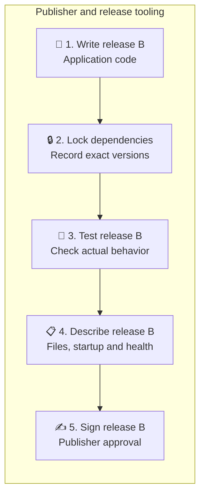
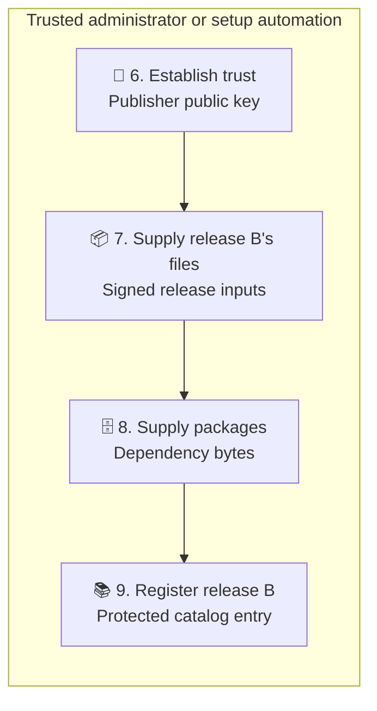
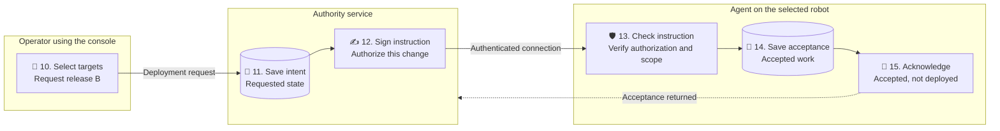
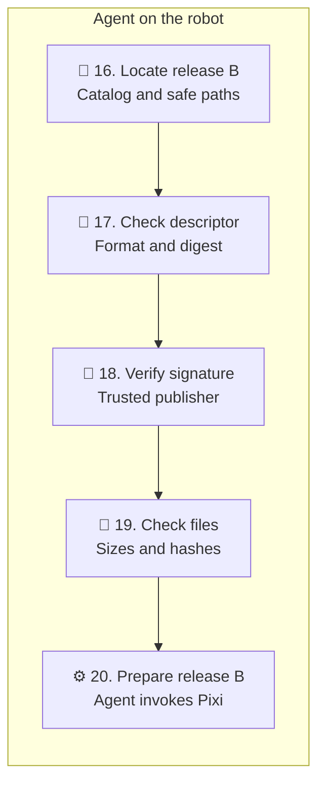
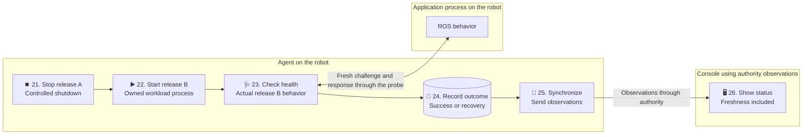
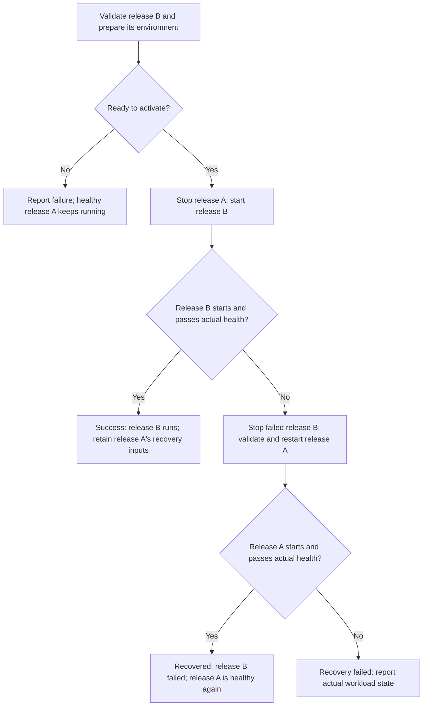

# From approved software to a running robot

Imagine a robot already running an application. Call that version **A**. You
have developed version **B**, and want the robot to run it instead.

FleetForge's **agent** is the service on the device that manages that change.
It prepares B, starts it, checks that it works, and attempts to recover A if B
fails. Pixi supplies the software environment the application needs.

Before switching, the agent needs to know exactly what B contains and whether
someone authorized to approve software endorsed those contents. We will build
up how it answers those questions, starting with ordinary files.

This is a walkthrough of the accepted design, not an executable tutorial.
The application deployment described here still needs implementation. See the
[README](../../README.md#current-state) for what runs today, the
[glossary](../product/glossary.md) for quick term lookups, and the
[release specification](../specs/releases.md) for the exact rules behind this guide.

## First, collect one software version into a release

A **release** is a fixed definition of one version of the application and its
runtime inputs. Imagine collecting B's files into a folder:

```text
Release B
├── app/          Application code
├── pixi.toml     Runtime dependency declarations
└── pixi.lock     Resolved dependency versions
```

The application code defines its behavior. The manifest, `pixi.toml`, declares
its dependencies; `pixi.lock` records the resolved versions. These files let
Pixi prepare an environment containing the packages the application needs.

Published release inputs are **immutable**: changing them creates another
release. “Deploy B” must keep meaning the same thing tomorrow, after a restart,
and during recovery. Otherwise a retry could install different software under
the same name.

The release inputs and the installed environment are separate. Think of the
inputs as an ingredients list and recipe, and the environment as the prepared
result. The actual dependency package bytes are another resource. A lockfile
identifies packages; it does not contain their contents. Having a shopping list
does not mean the ingredients are already in the cupboard. The required package
bytes must be local if we want a fresh installation without internet.

A and B each own a separate Pixi workspace, manifest, lockfile and environment.
Their environment name is initially `default`. That means the runtime selected
from that release's own manifest, not FleetForge's root development workspace:

```text
FleetForge's root pixi.toml
├── host       Contributor tooling
└── device     FleetForge device development and checks

Release A's pixi.toml → its default environment → application A's runtime
Release B's pixi.toml → its default environment → application B's runtime
```

These independent environments let the agent prepare B while A still runs.

## Add a contents list and instructions: the descriptor

The robot also needs instructions: which files belong to B, how to start it,
and how to check whether it works. We put this information in `release.json`,
called the **release descriptor**. JSON is structured text whose named fields
are readable by people and software.

Start with these selected fields from B's descriptor:

```json
{
  "release_id": "example-b-v1",
  "platform": "linux-64",
  "runtime": { "environment": "default" },
  "entrypoint": {
    "argv": ["bin/python", "app/main.py"],
    "cwd": "."
  }
}
```

Read this as: “This release is named `example-b-v1`, targets Linux x86_64,
and uses its own default Pixi environment. Start that environment's Python
interpreter with `app/main.py`, from the release workspace directory.”

`release_id` gives us a stable name. `entrypoint` describes the starting command:
`argv` is its list of literal command arguments, and `cwd` is its working
directory; `.` means the release workspace itself.

The examples in this guide show selected fields so we can introduce one concept
at a time. Later excerpts add fields from this same descriptor; they are not
separate descriptor files. Required fields are omitted, so these snippets are
not complete deployment inputs. Values in angle brackets will stand in for
long calculated values.

## Check whether files changed: fingerprints and hashing

A contents list alone cannot tell us whether a local file has changed. To check
that, we calculate a **hash**: a fixed-length value computed from the file's
exact stored bytes. You can think of the result as a fingerprint. **Digest** is
another word for the calculated hash value; **hashing** is the calculation.

FleetForge uses a hash algorithm called **SHA-256**:

```text
Application file → SHA-256 calculation → file fingerprint
```

Changing a file will almost certainly change its fingerprint. The descriptor
records the expected fingerprint, and the robot calculates the local file's
fingerprint and compares the two. The `files` part of the same descriptor looks
like this:

```json
{
  "files": [
    {
      "path": "app/main.py",
      "sha256": "<main-file-hash>"
    }
  ]
}
```

`<main-file-hash>` stands for the expected fingerprint of `app/main.py`. The
complete descriptor also lists the other required files and each file's byte
size. If someone changes `app/main.py` but leaves the descriptor alone, the
comparison fails.

We also calculate a fingerprint of the **complete descriptor**, represented
here as `sha256:<B-descriptor-hash>`. This identifies B's entire definition,
including file fingerprints, starting instructions and health policy. It is
different from `<main-file-hash>`, which identifies just one application file.
Deployment requests carry both B's release ID and this descriptor digest.

A hash answers “do these bytes match the expected bytes?” It does not answer
“who approved them?” Someone who replaces the application could also replace
its recorded fingerprint in the descriptor. We need another check for approval.

## Establish approval: a publisher, two keys and a signature

A **publisher** is a person or system authorized to approve software releases.
Initially, that could be a maintainer using a local signing tool.

The publisher creates a **key pair**, two related pieces of data with different
jobs:

| Key         | Purpose            | Location                                                   |
| ----------- | ------------------ | ---------------------------------------------------------- |
| Private key | Creates signatures | Protected on the publisher's signing machine               |
| Public key  | Checks signatures  | Supplied to the authority and robots through trusted setup |

A **digital signature** is a value created from a message and the private key.
The matching public key can check whether that signature approves those exact
message bytes. It cannot create a valid signature itself.

```text
Publisher: descriptor message + private key → signature
Robot:     descriptor message + signature + public key → valid or invalid
```

The private key must stay secret. Someone who obtains it can approve software
as that publisher. The public key can be shared, and readers can check signatures
without contacting the publisher. Private publisher keys never belong on robots
or in the repository.

FleetForge uses a signature algorithm called **Ed25519**. The publisher gives
the public key a lookup label, or **key ID**. The same descriptor therefore
also contains:

```json
{
  "signing": {
    "algorithm": "Ed25519",
    "key_id": "example-publisher-1"
  }
}
```

The publisher's tool signs the complete descriptor in its prescribed byte
representation, including that `signing` object. It also includes a fixed label
identifying the message as a FleetForge release descriptor, so it cannot be
mistaken for a different kind of signed message. The tooling handles the exact
encoding; we return to it later in the guide.

The resulting signature is stored in a separate file, `release.sig.json`:

```json
{
  "schema_version": 1,
  "descriptor_digest": "sha256:<B-descriptor-hash>",
  "signature": "<signature-created-with-the-publisher-private-key>"
}
```

This file is called the signature **envelope**: it holds the signature and the
fingerprint of the descriptor it accompanies. `schema_version` identifies the
format version. Copying a fingerprint into this envelope cannot establish
approval by itself; the signature must verify against the actual descriptor.

Changing the descriptor makes its existing signature fail. The signature
protects the descriptor, whose file fingerprints protect the application files.
If someone changes both an application file and its recorded fingerprint, they
also need the trusted publisher's private key to create a new valid signature.

This does not encrypt the release; its contents remain readable. A valid
signature establishes approval by the corresponding private key. It does not
prove that the application is bug-free or safe. Review, tests, workload
permissions and actual health verification are still needed.

A publisher can use one key pair to sign multiple releases. It need not generate
a new pair for every release or robot. Losing the private key prevents new
signing with it, but public-key verification of existing signatures can still
work. Suspected theft requires an explicit trust-replacement response.

## Decide whose approval to accept: the keyring

We now know how to check a signature using a public key. But which public key
should the robot accept? An attacker can generate their own key pair too.

Trusted setup installs a **publisher keyring** on the robot: a small configuration
file listing the publisher public keys that installation accepts. For example,
`publisher-keyring.json` contains:

```json
{
  "schema_version": 1,
  "publishers": [
    {
      "key_id": "example-publisher-1",
      "algorithm": "Ed25519",
      "public_key": "<trusted-public-key>"
    }
  ]
}
```

The robot reads `example-publisher-1` from the descriptor's `signing` object,
finds that ID in its own keyring, and checks the signature with the associated
public key. The label alone proves nothing: a different key using the same
label still fails verification.

A release cannot supply a new public key and declare itself trusted; an attacker
could do that too. Although public keys are not secret, permission to edit the
keyring matters. Adding a key changes whose releases the robot accepts. Managed
applications must therefore be unable to change it.

These checks catch different kinds of replacement:

| What changed?                                               | What should happen?                                             |
| ----------------------------------------------------------- | --------------------------------------------------------------- |
| One application file, but not its descriptor                | The file's calculated fingerprint differs from the expected one |
| Application file and recorded fingerprint in the descriptor | The old signature no longer verifies the changed descriptor     |
| The whole release, signed with an attacker's own key        | The robot rejects a key it has not been configured to trust     |

## Find B on disk: the catalog

The robot needs to locate B's files too. The **catalog** is a local lookup table
mapping release IDs to expected descriptor digests and directories. Here is
`catalog.json`:

```json
{
  "schema_version": 1,
  "releases": [
    {
      "release_id": "example-b-v1",
      "descriptor_digest": "sha256:<B-descriptor-hash>",
      "directory": "example-b-v1"
    }
  ]
}
```

The release ID matches the descriptor. The descriptor digest matches the
signature envelope and the fingerprint requested in a deployment. The directory
tells the robot where to look under its configured release root. A directory's
name alone does not establish what it contains or who approved it.

If a request asks for B with fingerprint X but the catalog or descriptor leads
to fingerprint Y, the robot rejects the mismatch. If B's directory is missing,
it reports that the release is unavailable.

Creating B on the publisher's machine does not update every robot. Each robot
that needs B must receive its files and a catalog entry before deployment.
Robots that will not use B need no update. A release signed by an already trusted
publisher can use the existing public key; a new release does not require a new
keyring entry.

Re-provisioning the same ID, digest and files is safe to repeat. Reusing an ID
for different contents is a conflict. The agent must report it rather than
choose the newest arrival as the winner. A future management tool can help a
publisher choose a new ID; it cannot change the meaning of an old ID already
recorded by robots.

The ID currently permits up to 64 ASCII characters. That length limit does not
generate names or prevent two publishers choosing `navigation-v1`. A generated-ID
convention and a management UI could prevent naming mistakes, with readable
names/versions kept as separate metadata. That convention is not prescribed yet.
One release can serve many robots using the same ID; the ID need not grow with
the number of robots.

## Put those documents together

We can now read the complete directory picture without introducing new security
terms. The private key stays on the signing machine. The robot receives:

```text
Robot's protected configuration
├── publisher-keyring.json        Whose signatures to trust
└── catalog.json                  Where to find local releases

Robot's release root
└── example-b-v1/
    ├── app/main.py               Application code
    ├── app/health.py             Application health check
    ├── pixi.toml                 Runtime dependency declarations
    ├── pixi.lock                 Resolved dependency versions
    ├── release.json              Contents, fingerprints and instructions
    └── release.sig.json          Signature and descriptor digest
```

When a valid deployment instruction requests `example-b-v1` with
`sha256:<B-descriptor-hash>`, the agent follows the connections we just built:

1. Find that ID/digest in the catalog and access its files within the protected
   release root, using the [safe-path checks explained below](#a-few-details-the-tooling-handles).
2. Calculate the descriptor's actual digest and compare it with the requested,
   catalog and signature-envelope values.
3. Read `example-publisher-1` from the descriptor, find its trusted public key
   in the keyring, and verify the signature over the complete descriptor message.
4. Calculate the actual `app/main.py` hash and compare it with
   `<main-file-hash>`. Check every other required file too.

Only after all required input checks succeed can preparation begin. These are
illustrative excerpts with symbolic values, not a signed release you can install.
A **fixture** is a deliberately prepared example used for review or testing.
The [complete review fixtures](../specs/fixtures/releases/README.md) provide
concrete file sizes, hashes and exact-byte examples; their placeholder applications
and deliberately invalid signature still do not form a runnable trusted release.

## Publisher, authority and device have separate powers

The **publisher** is the person, team or signing automation responsible for
approving a release. Its signature says, “I approve these exact software inputs.”
That approval makes the release eligible for deployment; it does not select
which robots should run it.

An **operator** makes that selection through the console. The **authority** is
the FleetForge service that checks the operator's permissions, records the
requested change and signs an instruction for the selected devices. It owns
what those devices are being asked to do.

The **agent** is the FleetForge service running on each robot. It checks the
instruction and the local release inputs, prepares the environment, supervises
the application, and handles health and recovery. It owns what actually happens
on that robot and reports what it observes. The robot is the host; the agent and
the managed application are separate processes with different permissions.

A **health probe** is a small program that checks whether the application
actually behaves as expected. The agent runs it and evaluates its response.
Other parts support those responsibilities:

| Part                         | Responsibility in this journey                                                                                                        |
| ---------------------------- | ------------------------------------------------------------------------------------------------------------------------------------- |
| Trusted setup                | An administrator or setup automation supplies protected trust, release files, package bytes and catalog entries before MVP deployment |
| Pixi                         | Resolves/locks dependencies during release preparation and installs the environment when the agent invokes it on a robot              |
| Application and health probe | Run the release's ROS behavior and participate in health checks; the agent evaluates the evidence                                     |
| Console/UI                   | Lets the operator request a change and displays observations received through the authority                                           |

For example, the authority can record that a robot should run release B while
the agent reports that release A is still running. Those are the requested and
observed states of the same deployment. The console must show the difference
and how recent the observation is.

One maintainer may perform several roles in a development setup, but publisher,
authority and device keys remain separate. Permission to request deployments
does not automatically grant permission to approve arbitrary new software.
Likewise, recognizing a device's connection credential does not grant it
deployment authority.

| Material              | What it establishes                                                          |
| --------------------- | ---------------------------------------------------------------------------- |
| Publisher signature   | Approval of an immutable release descriptor                                  |
| Authority signature   | An authorized deployment instruction bound to its intended assignment/device |
| Transport credentials | The identities of peers establishing a protected connection                  |

The [security architecture](../architecture/security.md) owns these boundaries.

## The complete journey to the robot

The planned MVP journey is split into five smaller diagrams. Read them in
order: steps 1–26 match the explanations immediately below each diagram.
Each diagram names the responsible participant. The handoffs carry different
things: the publisher supplies approved software, trusted setup makes it locally
available, the authority sends an authorized instruction, and the agent sends
back observations.

### Publisher: create and approve the release — steps 1–5

The publisher works on the signing/build machine. The robot can keep running
release A throughout this work.



1. **Write release B.** The publisher creates the new application's code and
   health probe. The robot continues running release A.
2. **Lock dependencies.** The publisher resolves release B's runtime
   dependencies and records their exact versions in its own lockfile.
3. **Test release B.** The publisher tests its real ROS behavior and health
   probe, including whether they distinguish release B from release A. A version
   label alone is insufficient.
4. **Describe release B.** The publisher's release tooling records the final
   files, sizes, hashes, runtime, startup command, health settings and signing
   key ID in the descriptor.
5. **Sign release B.** The publisher signs the prescribed descriptor message
   with its private key, which stays on the signing machine. Changing the
   release afterward requires a new release ID and a new signature.

### Trusted setup: supply local inputs — steps 6–9

An administrator or trusted setup automation now makes the approved release
available on the relevant robots. Supplying it does not start the application.



6. **Establish publisher trust.** Trusted setup installs the publisher's public
   key in the protected keyring when needed. An already trusted key can verify
   later releases without another keyring change.
7. **Supply release B's files.** Trusted setup places its descriptor, signature,
   application files, manifest and lockfile under protected release storage.
8. **Supply dependency bytes.** Trusted setup supplies the packages needed to
   prepare release B without downloading them from public services. These bytes
   and release B's future installed environment are different resources.
9. **Register release B locally.** Trusted setup supplies a protected catalog
   entry mapping release B's ID and descriptor digest to its directory. The
   authority also receives the catalog and publisher trust needed to identify
   approved releases. Conflicting ID/digest bindings must fail explicitly.

Steps 6–9 describe setup prerequisites, not a requirement to replace keys for
every release or to follow one fixed provisioning script. Release B's installed
environment can still be absent when setup finishes.

This trusted setup can be scripted through an existing secure administration
connection; it need not involve physically visiting each robot. FleetForge's
MVP deployment instruction identifies pre-provisioned software and does not
transfer its files.

Future [artifact delivery design
#51](https://github.com/gleniosp/fleetforge/issues/51) and [transfer
implementation #64](https://github.com/gleniosp/fleetforge/issues/64) cover
authorized remote delivery. That flow would receive release B in separate
staging, verify complete trusted inputs, and register release B as locally
available before deployment, while release A keeps running. How verified
availability updates the catalog must be specified by that future design; it is
not automated by this contract.

### Operator, authority and agent: request and accept — steps 10–15

The operator chooses a deployment. The authority authorizes and records that
choice; the agent then checks and records its own acceptance. Each service keeps
its own durable record, so either can restart without losing its part of the work.



10. **Select release B and its targets.** An authenticated operator requests
    release B for selected devices.
11. **Save desired intent.** After checking the operator's permissions, the
    authority durably records the requested change, so its own restart does not
    erase what should happen.
12. **Sign the instruction.** The authority binds the target assignment,
    generation, release ID and descriptor digest into an authorized instruction.
    A **generation** is an increasing instruction number for that device's
    assignment under that authority. For example, deploying release B at
    generation 7 and later requesting release A at generation 8 lets the agent
    recognize the newer request, even though it returns to older software.
    The instruction reaches the robot through the device-initiated authenticated
    connection.
13. **Check the instruction.** The agent verifies authorization and that the
    instruction belongs to this device and assignment, applying the protocol's
    generation and duplicate-handling rules.
14. **Save acceptance.** The agent durably records accepted intent in its local
    state before deployment side effects, so a restart can discover the work it
    accepted.
15. **Acknowledge acceptance.** Only after that record is durable does the
    agent acknowledge it. An unreachable device remains pending. Acceptance
    does not prove that release B is installed, running or healthy.

Accepted work can finish locally during authority loss when trusted inputs and
resources remain available.

### Agent: verify the release and prepare its environment — steps 16–20

The agent now works with the robot's local inputs. It verifies them before
asking Pixi to install the environment; the agent remains responsible for
deciding whether preparation succeeded and activation may proceed.



16. **Locate release B safely.** The agent checks the requested ID/digest against
    the local catalog and accesses release B's protected directory without
    following unsafe paths or links.
17. **Check the descriptor.** The agent parses its exact bytes, validates the
    supported format/runtime, and compares its computed digest with the
    instruction, catalog and signature-envelope values.
18. **Verify publisher approval.** The agent resolves the descriptor's signing
    key ID in the trusted keyring and verifies its signature. A matching hash
    alone cannot establish publisher approval.
19. **Check every required file.** The agent validates the complete file set,
    safe paths, byte sizes and hashes, plus manifest/lock consistency. No
    installation or application code runs before the required input checks
    succeed.
20. **Prepare release B's environment.** The agent invokes Pixi to prepare a
    separate environment from release B's locked inputs, then checks the result.
    Release A keeps running. Fresh offline installation depends on the proven
    package-cache strategy; the lockfile
    alone does not supply packages.

These checks establish which software may be prepared; they do not prove that
release B will run successfully. Activation must use still-trusted, verified
inputs, through rechecking or an equally protected immutable snapshot.

### Agent and console: run the application and report — steps 21–26

The agent controls the local switch and evaluates the workload's health. It
reports what happened to the authority; the console displays that evidence for
the operator.



21. **Stop release A.** Once release B is ready, the agent begins the
    controlled switch by stopping release A. Preparation kept release A
    running; this switch can interrupt service.
22. **Start release B.** The agent launches release B's prescribed command in
    its prepared environment, with a fresh process-instance ID and agent-owned
    supervision. The application runs as a separate workload process.
23. **Check release B's health.** The agent runs the probe, which exchanges a
    fresh challenge with the actual ROS workload. The agent checks its behavior,
    release identity and current process instance. Installation success alone
    cannot satisfy this step. On failure, the agent follows the recovery flow
    below.
24. **Record the outcome.** The agent persists the actual observed result:
    release B succeeded, release B failed and release A recovered, or recovery
    also failed. An attempted restart is insufficient evidence of successful
    recovery.
25. **Synchronize observations.** The agent sends recorded outcomes and current
    observations to the authority when connected. A disconnection can delay
    this reporting.
26. **Show the observed status.** The UI displays the device evidence and its
    freshness, including stale or unknown state when current evidence is absent.

The diagrams follow the successful path; the next diagram expands what happens
when preparation, activation or health checks fail. Publisher approval, authority
authorization, installation and application health each answer a different
question. Passing an earlier step does not skip the later ones.

### What can fail, and what stays running?



Missing files, an unknown publisher key, a bad signature or a missing
dependency package should fail before disrupting healthy release A. Once
activation starts, controlled stop/start can interrupt service. Recovery must
verify release A's actual behavior; merely attempting to restart it cannot
establish recovery success.

If release B succeeds and the operator later requests release A, that is an
explicit rollback through a new deployment generation. It is a new requested
change, separately recorded from automatic recovery after a failed release B
attempt.

### Why health includes process identity and a fresh challenge

A live process alone does not prove that the application works. An old ROS
process or a neighboring robot could also answer a careless health check.

For each new workload process, the agent creates a fresh process-instance ID.
For each probe it creates a fresh, unpredictable challenge, or **nonce**, used
for that one check. The probe exchanges
that challenge with the actual workload through ROS and checks the response's
release, descriptor digest, process identity and observed application behavior.

Think of it as asking the expected new process a fresh question. Reading a static
file, repeating an old response or echoing the probe's own environment cannot
satisfy the contract. Isolated ROS domains and private endpoints help ensure
the answer comes from the intended workload. The exact interface is in the
[health contract](../specs/releases.md#entrypoint-and-ros-health).

## A few details the tooling handles

**Canonical JSON** gives the descriptor one prescribed byte representation.
Ordinary JSON permits different spacing and property order. A shared encoding
lets different tools calculate the same descriptor fingerprint and signing
message. The readable examples are accompanied by exact byte vectors.

For instance, `{"a":1,"b":2}` and `{ "b": 2, "a": 1 }` describe the same
ordinary JSON object but have different bytes. The release contract chooses one
standard encoding before hashing/signing and requires stored descriptor bytes
to match it. A reviewer should not manually reformat a published descriptor:
formatting is part of those exact bytes too.

A **detached signature** lives in a separate file, keeping it outside the
descriptor being signed. A fixed **domain/version prefix** in the signing
message identifies its purpose as a FleetForge release descriptor, helping
prevent confusion with another kind of signed message. The specification uses
standard JCS encoding and Ed25519 signatures through established libraries.

**Safe paths and ownership** keep approved bytes within protected directories
and prevent a workload replacing them after verification. A correct signature
cannot compensate for executing different files from those checked earlier.

To "open a directory" means asking the operating system for access so the agent
can read its files. Doing that safely means keeping access inside the protected
release root and ensuring the files read are the ones verified.

For example, `app/main.py` stays inside the release directory. `../other/main.py`
tries to leave it. A symbolic link, a filesystem shortcut, could redirect an
innocent-looking name elsewhere. Another process could also replace a file
between checking and using it. The implementation must reject unsafe paths and
links, use operating-system access mechanisms that resist those replacements,
and enforce ownership that prevents the workload changing verified inputs.
Checking a path string once is insufficient. The specification defines these
requirements; the file-access implementation remains with the integrity delivery.

The initial contract also bounds paths to 240 characters and one local catalog
to 1,024 entries. These are finite-input policies, not measured filesystem or
fleet capacity limits. Longer legitimate layouts can exist; the configured root
also adds to the full filesystem path. A larger release history might eventually
need a different bounded index or retention design. Increasing a bound does not
remove safe-path checks or permit deleting recovery inputs. The
[input-limit contract](../specs/releases.md#paths-files-and-finite-input-bounds)
owns the exact rules and revisit conditions.

The [contract and schemas](../specs/releases.md) own these exact rules. Developers
should use the release tooling once implemented, rather than construct signing
messages or perform these checks by hand.

## What the example releases demonstrate today

There are two kinds of examples. The
[runnable ROS workloads](../../examples/ros-workloads/README.md) let developers
install A/B in separate environments and check their actual behavior and health.
They are unsigned and demonstrate the runtime foundation, not a complete
deployment lifecycle. Their guide explains why the counter example is useful
and how to run it.

The [document review fixtures](../specs/fixtures/releases/README.md) show how the
release contract's documents fit together. The details below describe those
illustrative documents, separately from the runnable workloads.

Their A/B descriptors have distinct IDs, fingerprints and intended behavior.
The payloads are tiny placeholder texts, not working applications or valid Pixi
runtime inputs. We can still calculate their exact sizes/hashes and check that
the descriptors and catalog agree. This exercises the relationship between the
documents without claiming that A or B can be installed.

| Example artifact         | What it lets us inspect                                                    |
| ------------------------ | -------------------------------------------------------------------------- |
| Readable A/B descriptors | Fields, starting instructions, health policy and publisher key ID          |
| Payload text map         | Exact example bytes that produce the file sizes and fingerprints           |
| Catalog                  | Matching release IDs, descriptor digests and local directories             |
| Keyring                  | Public-key configuration shape, using a published test key                 |
| Signature envelope       | Correct structure with a deliberately invalid signature                    |
| Byte vectors             | Exact canonical descriptor and signing-message bytes plus expected digests |

“Passes the schema” means a document has the expected fields, types and allowed
values. It does not mean its signature is valid or its application works. The
all-zero example signature deliberately demonstrates that difference: it fits
the envelope shape but must never establish trust.

The readable descriptors contain indentation and a final newline for source
review. Their exact canonical counterparts are recorded as hexadecimal strings
in the byte vectors. Each pair of hex characters represents one byte; the schema
helper `hex_32_bytes`, for example, describes 32 raw bytes written as 64 hex
characters. Decoding a vector recovers the exact bytes used for its fingerprint.

The runnable ROS workload delivery is #11; generated signing fixtures and
cryptographic rejection tests belong to #86. These document review fixtures
must not be installed or provisioned as trusted operational inputs.

## Manual setup now, separate lifecycle work later

The initial design uses manually provisioned publisher public keys and local
trust replacement. In this format the signing key ID is inside the descriptor.
Changing it changes the descriptor digest and therefore requires a new release
ID. This is a FleetForge design choice that keeps each ID bound to one exact
descriptor.

Retain old public key bindings while active or known-good releases need them.
Removing a key too early could prevent restart or recovery of those releases.
An explicit distrust decision needs an inventory of affected releases and trusted
replacements; an offline robot learns that decision only when policy reaches it.

The future work is split because enrolling devices and managing publisher keys
serve different purposes:

| Future delivery                                                                                              | Purpose                                                                                                            |
| ------------------------------------------------------------------------------------------------------------ | ------------------------------------------------------------------------------------------------------------------ |
| [#57 — Production enrollment and trust lifecycle design](https://github.com/gleniosp/fleetforge/issues/57)   | Specify production trust, compromise and lifecycle policies                                                        |
| [#58 — Device enrollment](https://github.com/gleniosp/fleetforge/issues/58)                                  | Replace manual device enrollment with an authenticated flow bound to ownership and assignment                      |
| [#99 — Device credential lifecycle](https://github.com/gleniosp/fleetforge/issues/99)                        | Implement device credential renewal, rotation and revocation                                                       |
| [#100 — Publisher signing and release metadata lifecycle](https://github.com/gleniosp/fleetforge/issues/100) | Protect publisher signing and implement key delegation, rotation/revocation and metadata freshness/recovery policy |

These are deferred FUT-06 deliveries, requiring explicit activation and design
refinement. They are not an automatic enrollment feature in the MVP. Production
publisher trust will use established metadata mechanisms selected by that work;
device enrollment is not itself a publisher-key distribution protocol. GitHub
owns their live scope and dependencies.

### Future release naming and larger catalogs

Existing deliveries cover parts of this area: [#13](https://github.com/gleniosp/fleetforge/issues/13)
owns local catalog integrity and conflict rejection,
[#51](https://github.com/gleniosp/fleetforge/issues/51) defines future artifact
delivery/resource policy, [#65](https://github.com/gleniosp/fleetforge/issues/65)
implements protected cache capacity/eviction, and
[#100](https://github.com/gleniosp/fleetforge/issues/100) hardens publisher trust
and release metadata. Cache byte retention and catalog entry capacity are distinct
resources; work on one does not automatically implement the other.

A release-ID generation convention, a publishing/management UI and a catalog
design beyond the initial document bound do not yet have explicit delivery
owners. The MVP console's deployment/rollback controls in
[#37](https://github.com/gleniosp/fleetforge/issues/37) choose provisioned software;
they do not establish a full release-publishing interface. These are planning
gaps to scope deliberately if that capability is activated. Further validation
and operator-assisted conflict handling can be added while preserving immutable
ID/digest bindings and explicit failure on conflicting inputs.

For deeper reading, continue with the [release contract](../specs/releases.md),
[trust decision](../adr/0006-signed-trust-and-privilege-boundaries.md),
[coordination contract](../architecture/coordination.md), or
[illustrative fixtures and failure cases](../specs/fixtures/releases/README.md).
